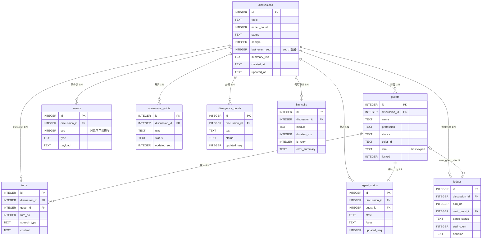

# data-model.md — 9 张表的结构与不变量

> 阶段：S0 契约冻结（SDD）
> 输入：`docs/REQUIREMENTS.md`（F1–F7 / T1–T4）、`specs/001-panel/spec.md`（行为与验收）
> 技术落点：SQLite 单文件 `server/data/app.db`，`better-sqlite3`，迁移在 `server/src/db/migrations/`
> 状态：**待人类裁决**（与 `spec.md` §7 同步）

通用约定：

- 主键统一 `INTEGER PRIMARY KEY AUTOINCREMENT`（自增、稳定、FK 友好；v1 单机本地应用，不暴露分布式 id）。
- 时间统一 `TEXT`，ISO-8601 UTC 毫秒精度，形如 `2026-11-17T08:30:00.000Z`。SQLite 无原生 datetime，字符串便于排序与 `Last-Event-ID` 比对。
- 布尔统一 `INTEGER NOT NULL CHECK (x IN (0,1))`。
- JSON 列统一 `TEXT`，写入前 `JSON.stringify`，读取后由 `shared/schemas` 的 zod 校验；禁止把 JSON 存成多个自由字段。
- 所有外键 `ON DELETE CASCADE` 指向 `discussions(id)`（讨论是唯一的聚合根），`PRAGMA foreign_keys = ON`。
- 连接参数：`journal_mode=WAL`、`busy_timeout=5000`、`synchronous=NORMAL`。

---

## 1. 表总览

| # | 表 | 职责 | 谁写 | 谁只读 |
|---|---|---|---|---|
| 1 | `discussions` | 讨论主体 + 状态机 + 事件序号计数器 | `modules/discussion` | 全部模块 |
| 2 | `guests` | 主持人 + 专家阵容，`locked` 后冻结 | `modules/guest` | `modules/turn` / `host` |
| 3 | `turns` | 已定稿的 transcript（数据流②的前端来源） | `modules/turn` | `modules/summary` / SSE |
| 4 | `events` | 唯一可重放的事件源（断线补发只读这张表） | `modules/sse/publish` **唯一写入口** | 全部 |
| 5 | `ledger` | 每轮调度账本（决策 + 停摆计数），前端不可见 | `modules/host` | 无（不对外） |
| 6 | `consensus_points` | 共识条目，增量更新 | `modules/summary`（提炼）/ `summary`（归并） | 前端 |
| 7 | `divergence_points` | 分歧条目，增量更新 | 同上 | 前端 |
| 8 | `agent_status` | 每位嘉宾的实时状态 + 公开关注点 | `modules/turn` / `host` | 前端 |
| 9 | `llm_calls` | 每次模型调用的成本与健康度审计 | `llm/client` | 报告 / 人工 |

---

## 2. 字段定义

### 2.1 `discussions` — 讨论

| 字段 | 类型 | 可空 | 默认 | 枚举 / 约束 | 说明 |
|---|---|---|---|---|---|
| `id` | INTEGER | 否 | 自增 | PK，`> 0` | 对外暴露的讨论 id |
| `topic` | TEXT | 否 | — | `length(topic) BETWEEN 1 AND 200` | 用户输入的议题原文 |
| `expert_count` | INTEGER | 否 | 4 | `BETWEEN 1 AND 8` | 只算 `role='expert'`，不含主持人 |
| `status` | TEXT | 否 | `'draft'` | `draft` / `generating` / `ready` / `running` / `finished` / `failed` / `cancelled` | 迁移见 `spec.md` §4.1；`cancelled` 为终态 |
| `session_id` | TEXT | 是 | NULL | `length ≤ 64` | 客户端匿名标识，仅用于区分发起者 / 观察者，不做鉴权 |
| `sample` | INTEGER | 否 | 0 | `0` / `1` | 样例数据标记；样例不加独立表，只是普通行 |
| `summary_text` | TEXT | 是 | NULL | `status='finished'` 时非空（空 transcript 用固定文案） | 150–250 字中文纯文本 |
| `error_code` | TEXT | 是 | NULL | `LLM_NOT_CONFIGURED` / `LLM_UPSTREAM_ERROR` / `ALL_SPEAKERS_FAILED`；**`status='cancelled'` 时恒为 NULL** | 与 `spec.md` §4.2 的 `code` 同名；取消不是错误 |
| `error_message` | TEXT | 是 | NULL | `length ≤ 500` | 仅供人工排查，不返回前端 |
| `last_event_seq` | INTEGER | 否 | 0 | `>= 0` | **事件序号计数器**，唯一取号点 |
| `created_at` | TEXT | 否 | 当前时间 | ISO-8601 UTC | — |
| `updated_at` | TEXT | 否 | 当前时间 | ISO-8601 UTC | 任何字段变更 / 事件写入都刷新，列表排序依据 |
| `started_at` | TEXT | 是 | NULL | 进入 `running` 时写 | — |
| `finished_at` | TEXT | 是 | NULL | 进入 `finished` / `failed` 时写 | — |

```sql
-- 取消与失败语义不得混用
CHECK (status <> 'cancelled' OR error_code IS NULL)
```

索引：

```sql
CREATE INDEX idx_discussions_updated  ON discussions(updated_at DESC);
CREATE INDEX idx_discussions_status   ON discussions(status, updated_at DESC);
CREATE INDEX idx_discussions_sample   ON discussions(sample, updated_at DESC);
```

### 2.2 `guests` — 嘉宾（主持人 + 专家）

| 字段 | 类型 | 可空 | 默认 | 枚举 / 约束 | 说明 |
|---|---|---|---|---|---|
| `id` | INTEGER | 否 | 自增 | PK | — |
| `discussion_id` | INTEGER | 否 | — | FK → `discussions(id)` | — |
| `name` | TEXT | 否 | — | `length BETWEEN 1 AND 32` | 讨论内唯一 |
| `profession` | TEXT | 否 | — | `length BETWEEN 1 AND 40` | 职业 / Title |
| `stance` | TEXT | 否 | — | `length BETWEEN 1 AND 60` | 立场一句话 |
| `color_id` | TEXT | 否 | — | `amber` / `rose` / `sky` / `emerald` / `violet` / `orange` / `teal` / `lime` / `indigo` / `fuchsia` | **固定 10 色板**，讨论内唯一（1 主持 + 最多 8 专家 = 9 行，留 1 色余量） |
| `role` | TEXT | 否 | — | `host` / `expert` | 每讨论恰好 1 个 `host` |
| `speaking_order` | INTEGER | 否 | — | `BETWEEN 0 AND 8` | 仅用于「最久未发言」同分时的稳定排序，**不是发言顺序** |
| `locked` | INTEGER | 否 | 0 | `0` / `1` | `1` 后不可增删改 |
| `created_at` | TEXT | 否 | 当前时间 | ISO-8601 UTC | — |

索引：

```sql
CREATE UNIQUE INDEX uq_guests_name        ON guests(discussion_id, name);
CREATE UNIQUE INDEX uq_guests_color       ON guests(discussion_id, color_id);
CREATE UNIQUE INDEX uq_guests_one_host    ON guests(discussion_id) WHERE role = 'host';
CREATE        INDEX idx_guests_discussion ON guests(discussion_id, role, speaking_order);
```

### 2.3 `turns` — 发言（transcript）

| 字段 | 类型 | 可空 | 默认 | 枚举 / 约束 | 说明 |
|---|---|---|---|---|---|
| `id` | INTEGER | 否 | 自增 | PK | — |
| `discussion_id` | INTEGER | 否 | — | FK → `discussions(id)` | — |
| `guest_id` | INTEGER | 否 | — | FK → `guests(id)` | 必须是该讨论 `locked=1` 的嘉宾（应用层校验） |
| `turn_no` | INTEGER | 否 | — | `>= 1`，讨论内唯一 | 发言序号，从 1 递增 |
| `speech_type` | TEXT | 否 | — | `opening` / `challenge` / `supplement` / `rebuttal` / `question` / `summary` | 主持人开场＝`opening`，收尾总结＝`summary` |
| `content` | TEXT | 否 | — | 按 `speech_type` 分支：`challenge/supplement/rebuttal/question` 为 `BETWEEN 1 AND 120`；`opening/summary` 为 `BETWEEN 1 AND 400` | 专家 1–2 句，超长按句末截断（`spec.md` AC-1.10）；主持人开场 / 总结不受 120 限 |
| `created_at` | TEXT | 否 | 当前时间 | ISO-8601 UTC | — |

索引：

```sql
CREATE UNIQUE INDEX uq_turns_turn_no   ON turns(discussion_id, turn_no);
CREATE        INDEX idx_turns_discussion ON turns(discussion_id, turn_no);
CREATE        INDEX idx_turns_guest    ON turns(guest_id, turn_no);
```

> **S2 建表时必须照抄这条 CHECK**，不要写成单一的 `length(content) BETWEEN 1 AND 120`：
>
> ```sql
> CHECK (
>       (speech_type IN ('challenge','supplement','rebuttal','question')
>          AND length(content) BETWEEN 1 AND 120)
>   OR (speech_type IN ('opening','summary')
>          AND length(content) BETWEEN 1 AND 400)
> )
> ```
>
> 否则主持人总结（150–250 字）永远插不进去，S9 会在最后一刻炸。

### 2.4 `events` — 事件（唯一可重放源）

| 字段 | 类型 | 可空 | 默认 | 枚举 / 约束 | 说明 |
|---|---|---|---|---|---|
| `id` | INTEGER | 否 | 自增 | PK | 仅内部使用 |
| `discussion_id` | INTEGER | 否 | — | FK → `discussions(id)` | — |
| `seq` | INTEGER | 否 | — | `>= 1`，`(discussion_id, seq)` 唯一 | 讨论内单调递增，SSE 的 `id:` 字段就是它 |
| `type` | TEXT | 否 | — | 前缀白名单：`state.` / `run.` / `agent.` / `turn.` / `consensus.` / `divergence.` | **精确取值由 `contracts/events.md`（S1）冻结**，本文件只冻结前缀与不得跨族共用 payload |
| `payload` | TEXT | 否 | — | 合法 JSON 对象，`length ≤ 4096` | 不含 prompt、不含 chain-of-thought、不含完整 ledger |
| `created_at` | TEXT | 否 | 当前时间 | ISO-8601 UTC | — |

索引：

```sql
CREATE UNIQUE INDEX uq_events_seq ON events(discussion_id, seq);
CREATE        INDEX idx_events_type ON events(discussion_id, type, seq);
```

> `uq_events_seq` 是并发写入的**最终防线**，不是主要机制（主要机制见 §4）。

### 2.5 `ledger` — 主持人调度账本

| 字段 | 类型 | 可空 | 默认 | 枚举 / 约束 | 说明 |
|---|---|---|---|---|---|
| `id` | INTEGER | 否 | 自增 | PK | — |
| `discussion_id` | INTEGER | 否 | — | FK → `discussions(id)` | — |
| `turn_no` | INTEGER | 否 | — | `>= 0`，讨论内唯一 | 决策发生时的发言序号（0＝开场前首次决策） |
| `is_request_satisfied` | INTEGER | 是 | NULL | `0` / `1` | 解析失败时为 NULL |
| `is_in_loop` | INTEGER | 是 | NULL | `0` / `1` | 同上 |
| `is_progress_being_made` | INTEGER | 是 | NULL | `0` / `1` | 同上 |
| `next_guest_id` | INTEGER | 是 | NULL | FK → `guests(id)` | 校验后落库的嘉宾 id；名单外的名字一律降级为最久未发言者 |
| `speech_type` | TEXT | 是 | NULL | 同 `turns.speech_type`，但**不含** `opening` / `summary` | 降级时固定 `supplement` |
| `instruction` | TEXT | 是 | NULL | `length ≤ 200` | 给该嘉宾的一句指令 |
| `parse_status` | TEXT | 否 | — | `structured` / `json_mode` / `fallback` | 对应三级降级 |
| `stall_count` | INTEGER | 否 | 0 | `BETWEEN 0 AND 3` | 本行决策后的停摆计数 |
| `decision` | TEXT | 否 | — | `speak` / `summarize` / `force_stop` | 纯函数 `decide()` 的输出动作 |
| `raw_json` | TEXT | 是 | NULL | 合法 JSON，`length ≤ 4096` | 模型原始决策 JSON（**只存决策，不存 prompt**），供人工复盘 |
| `created_at` | TEXT | 否 | 当前时间 | ISO-8601 UTC | — |

索引：

```sql
CREATE UNIQUE INDEX uq_ledger_turn ON ledger(discussion_id, turn_no);
CREATE        INDEX idx_ledger_disc ON ledger(discussion_id, turn_no DESC);
```

> 本表**不对外**：任何 REST / SSE 响应不得携带 `ledger` 字段（`spec.md` AC-1.17）。

### 2.6 `consensus_points` — 共识条目

| 字段 | 类型 | 可空 | 默认 | 枚举 / 约束 | 说明 |
|---|---|---|---|---|---|
| `id` | INTEGER | 否 | 自增 | PK | — |
| `discussion_id` | INTEGER | 否 | — | FK → `discussions(id)` | — |
| `text` | TEXT | 否 | — | `length BETWEEN 1 AND 120`，讨论内唯一 | 一句话共识 |
| `status` | TEXT | 否 | `'provisional'` | `provisional` / `final` / `dropped` | 只允许 `provisional → final`、`provisional → final → dropped`（单向，不回退） |
| `support_guest_ids` | TEXT | 是 | NULL | JSON 数组，元素为 `guests.id` | 支持该条的嘉宾，渲染「谁同意」 |
| `round_no` | INTEGER | 是 | NULL | `>= 1` | 首次出现的提炼窗口号 |
| `updated_seq` | INTEGER | 否 | — | `>= 1`，等于某条 `events.seq` | 前端增量渲染的唯一依据 |
| `created_at` | TEXT | 否 | 当前时间 | ISO-8601 UTC | — |
| `updated_at` | TEXT | 否 | 当前时间 | ISO-8601 UTC | — |

索引：

```sql
CREATE UNIQUE INDEX uq_consensus_text ON consensus_points(discussion_id, text);
CREATE        INDEX idx_consensus_seq  ON consensus_points(discussion_id, status, updated_seq);
```

### 2.7 `divergence_points` — 分歧条目

结构与 `consensus_points` **完全同构**（同字段、同类型、同约束、同索引形态），仅表名与语义不同：

| 字段 | 类型 | 可空 | 默认 | 枚举 / 约束 | 说明 |
|---|---|---|---|---|---|
| `id` | INTEGER | 否 | 自增 | PK | — |
| `discussion_id` | INTEGER | 否 | — | FK → `discussions(id)` | — |
| `text` | TEXT | 否 | — | `length BETWEEN 1 AND 120`，讨论内唯一 | 一句话分歧（须写明对立两面） |
| `status` | TEXT | 否 | `'provisional'` | `provisional` / `final` / `dropped` | 同上，单向 |
| `support_guest_ids` | TEXT | 是 | NULL | JSON 数组 | 持正方观点的嘉宾 |
| `round_no` | INTEGER | 是 | NULL | `>= 1` | — |
| `updated_seq` | INTEGER | 否 | — | `>= 1` | 增量渲染依据 |
| `created_at` | TEXT | 否 | 当前时间 | ISO-8601 UTC | — |
| `updated_at` | TEXT | 否 | 当前时间 | ISO-8601 UTC | — |

```sql
CREATE UNIQUE INDEX uq_divergence_text ON divergence_points(discussion_id, text);
CREATE        INDEX idx_divergence_seq  ON divergence_points(discussion_id, status, updated_seq);
```

### 2.8 `agent_status` — 专家状态（独立于 transcript）

| 字段 | 类型 | 可空 | 默认 | 枚举 / 约束 | 说明 |
|---|---|---|---|---|---|
| `id` | INTEGER | 否 | 自增 | PK | — |
| `discussion_id` | INTEGER | 否 | — | FK → `discussions(id)` | — |
| `guest_id` | INTEGER | 否 | — | FK → `guests(id)`，`(discussion_id, guest_id)` 唯一 | 每位嘉宾恒为 1 行 |
| `state` | TEXT | 否 | `'idle'` | `idle` / `preparing` / `speaking` | 嘉宾确认时建行，全部为 `idle` |
| `focus` | TEXT | 是 | NULL | `length ≤ 80`，禁止推理原文 | 公开关注点（如「成本 vs 体验」） |
| `updated_seq` | INTEGER | 否 | 0 | `>= 0`，0 表示尚未产生事件 | 最近一次更新对应的 `events.seq` |
| `updated_at` | TEXT | 否 | 当前时间 | ISO-8601 UTC | — |

```sql
CREATE UNIQUE INDEX uq_agent_status_guest ON agent_status(discussion_id, guest_id);
CREATE        INDEX idx_agent_status_state ON agent_status(discussion_id, state);
```

### 2.9 `llm_calls` — 模型调用审计（控额度用）

| 字段 | 类型 | 可空 | 默认 | 枚举 / 约束 | 说明 |
|---|---|---|---|---|---|
| `id` | INTEGER | 否 | 自增 | PK | — |
| `discussion_id` | INTEGER | 是 | NULL | FK → `discussions(id)` | 允许 NULL（无归属的连通性探测） |
| `module` | TEXT | 否 | — | `guest` / `ledger` / `turn` / `consensus` / `summary` | 与 `server/src/modules/` 同名 |
| `provider` | TEXT | 否 | `'deepseek'` | `deepseek` | v1 单供应商 |
| `model` | TEXT | 否 | — | `length ≤ 64` | 实际模型名 |
| `duration_ms` | INTEGER | 否 | — | `>= 0` | 端到端耗时（含重试） |
| `prompt_tokens` | INTEGER | 是 | NULL | `>= 0` | 上游未返回时为 NULL |
| `completion_tokens` | INTEGER | 是 | NULL | `>= 0` | 同上 |
| `total_tokens` | INTEGER | 是 | NULL | `>= 0` | 同上 |
| `is_retry` | INTEGER | 否 | 0 | `0` / `1` | 1＝本次为二次重试调用 |
| `success` | INTEGER | 否 | — | `0` / `1` | 校验通过且解析成功才为 1 |
| `error_summary` | TEXT | 是 | NULL | `length ≤ 200` | 仅错误码 / 失败字段名 / HTTP 状态，**禁止粘贴 prompt 或完整响应** |
| `created_at` | TEXT | 否 | 当前时间 | ISO-8601 UTC | — |

```sql
CREATE INDEX idx_llm_calls_disc   ON llm_calls(discussion_id, created_at);
CREATE INDEX idx_llm_calls_module ON llm_calls(module, created_at);
```

> 额度核算口径：某讨论的调用次数 = `SELECT COUNT(*) FROM llm_calls WHERE discussion_id = ?`；
> 「是否重试过」= `MAX(is_retry)`；token 成本按 `module` 汇总。**表内没有 prompt 原文，也没有响应原文。**

---

## 3. 关系图



---

## 4. `events.seq` 的单调性与并发保证

**结论**：`seq` 在每个 `discussion_id` 内单调递增、无空洞、无重复，且提交顺序 = 推送顺序。

实现规则（四条，缺一不可）：

1. **唯一写入口**：只有 `server/src/modules/sse/publish.ts` 能 `INSERT INTO events`。其他模块（turn / host / summary）只能调用 `publish(discussionId, type, payload)`，不得直接写表。
2. **取号与写入同一事务**（`BEGIN IMMEDIATE`），事务内顺序固定：

   ```sql
   BEGIN IMMEDIATE;
   UPDATE discussions
      SET last_event_seq = last_event_seq + 1,
          updated_at     = :now
    WHERE id = :discussionId
    RETURNING last_event_seq;          -- 拿到本次 seq
   INSERT INTO events(discussion_id, seq, type, payload, created_at) VALUES (...);
   -- 同一事务内同步更新源头表（turns / agent_status / consensus_points ...）
   COMMIT;
   ```

   序号由 `discussions.last_event_seq` 单一计数器发放，不存在「先查 MAX(seq) 再插入」的读-改-写竞态。
3. **唯一索引兜底 + 重试**：`uq_events_seq` 捕获 `SQLITE_CONSTRAINT` 时整事务回滚并重试，**重试必须重新取号**，最多 3 次；3 次仍失败则抛错并让该讨论置 `failed`，不得跳过该事件继续推进。
4. **先提交，后推送**：只有 `COMMIT` 成功才向订阅者推送；推送失败不回滚（事件已落库，重连时按 `Last-Event-ID` 补齐）。因此「已落库未推送」是唯一允许的中间态，「已推送未落库」永不发生。

补充：`better-sqlite3` 是同步 API、单进程 Node，天然串行；WAL 让读不阻塞写。**多进程 / 多实例写同一个库不在 v1 范围**，若未来扩展需改为单写队列 —— 但 `seq` 语义不变，接口不变。

`turn_no` 同理：在同一事务内 `SELECT COALESCE(MAX(turn_no), 0) + 1 FROM turns WHERE discussion_id = ?`，配合 `uq_turns_turn_no` 兜底。

---

## 5. 不变量（INV，任何 PR 破坏即视为契约破坏）

| # | 不变量 | 违反后果 |
|---|---|---|
| INV-1 | `events` 表**只增不改不删**；唯一例外是讨论删除时的级联删除。`seq` 不复用、不回补空洞 | 断线补发会错乱、前端去重失效 |
| INV-2 | `guests.locked=1` 后，该讨论的 `guests` 行不得 INSERT / UPDATE / DELETE | 发言指向不存在的嘉宾，F2 锁定失效 |
| INV-3 | 每条 `turns.guest_id` 必须属于同一 `discussion_id` 且 `locked=1` | 跨讨论串人 |
| INV-4 | `agent_status` 每 `(discussion_id, guest_id)` 恰好 1 行，嘉宾确认时创建，讨论结束前不删除 | 状态小窗裂成多行 / 前端重复渲染 |
| INV-5 | `consensus_points` / `divergence_points` 的 `status` 单向：`provisional → final → dropped`，禁止 `dropped → final`、禁止改回 `provisional` | 前端淡出的条目会「复活」 |
| INV-6 | `updated_seq` 必须等于产生该次变更的 `events.seq`，且 ≤ 该讨论当前 `last_event_seq` | 前端增量渲染漏条目 |
| INV-7 | `llm_calls` 不含 prompt / 响应原文；`ledger.raw_json` 只含决策 JSON，不含 prompt | T1 泄露风险 + 额度审计表膨胀 |
| INV-8 | `discussions.status` 只能按 `spec.md` §4.1 迁移 | 状态机与 SSE `state.*` 不一致 |

一致的「一笔发言」写入单元（同一个事务，顺序固定）：

```
取 seq → INSERT events(turn.started) → UPDATE agent_status(state='speaking', updated_seq)
       → 取 turn_no → INSERT turns → INSERT events(turn.done) → UPDATE agent_status(state='idle')
       → UPDATE discussions.updated_at
```

**transcript 与事件流不允许漂移**：一条 `turns` 行必定对应一条 `turn.done`，反之亦然；任何一侧单独存在即视为脏数据。

---

## 6. 样例数据（`sample=1`，S2 落地时的硬约束）

样例不加独立表，直接作为普通 `discussions / guests / turns / consensus_points / divergence_points` 行写入，`discussions.sample=1`：

- 至少 5 场讨论，覆盖 `status`：≥2 场 `finished`（须有 `summary_text`、≥1 条 `final` 共识、≥1 条 `final` 分歧）、≥1 场 `running`（≥6 条 `turns`、≥2 条 `provisional` 条目，便于演示实时观察）、≥1 场 `draft` 或 `ready`。
- 每场 **1 位 `host` + 4 位 `expert`（共 5 行 `guests`）**，即 `expert_count=4`（默认值）；`color_id` 两两不同，`locked=1`，且每位嘉宾都有一条 `agent_status` 行与一条 `agent.status` 事件。
- 每场 8–12 条 `turns`，`turn_no` 连续、`speech_type` 去重后 ≥ 3 种（满足 `spec.md` AC-1.21）；`turns.content` 均为中文 1–2 句（`summary` 那条 150–250 字）。
- 每场 2 条 `consensus_points` + 2 条 `divergence_points`，`updated_seq` 指向该场真实存在的 `events.seq`。
- `events` 必须齐全到「可重放」：观察者从 `Last-Event-ID: 0` 接入即可还原整场。
- `seed.ts` 幂等：以 `sample=1` 为识别键，重复执行不产生新行（先删 `sample=1` 的讨论再重建，或按 `topic` 判重）。

> 裁决：`expert_count` 默认 4 = **4 位专家 + 1 位主持人 = 5 行 `guests`**。`docs/SESSION_MAP.md` S2 原文的「4 位嘉宾阵容」措辞已同步更正为「5 行 guests」。本文件为唯一口径。

---

## 7. 迁移与校验清单（S2 落地时逐条打勾）

- [ ] `001_init.sql` 建 9 张表 + 全部索引，含 `uq_events_seq`、`uq_guests_one_host`（部分索引）
- [ ] 每条 `CHECK` 与本文「枚举 / 约束」列逐字对应
- [ ] `PRAGMA foreign_keys = ON`，且 `migrate.ts` 幂等（`schema_migrations` 记录版本）
- [ ] `shared/schemas/` 的 zod 枚举与本文枚举**同源生成**，不手写第二份
- [ ] 任一 `INSERT` 走事务，不存在跨表半写状态
